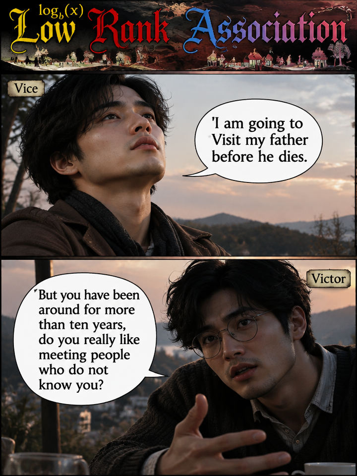
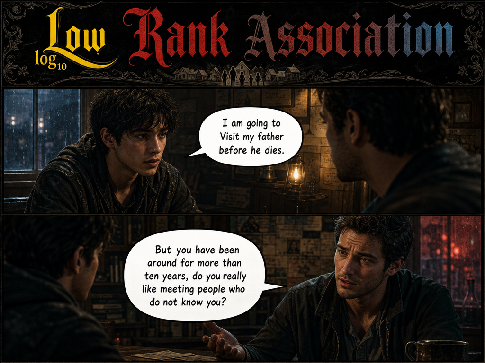

# Psychology: Family, Memory, and Return

The *Psychology* story explores a subtle but fundamental question:

> Are people guided by what they like, or by deeper psychological processes that unfold regardless of preference?

In the dialogue, Vice argues that certain reunions belong not to personal taste but to the natural progression of a human life. Losel seeks understanding, Victor seeks reassurance, and Vice follows what he perceives as the next stage of the journey.

The accompanying artwork captures this tension between present identity and historical identity, between the people who know us now and the people who knew us before we knew ourselves.

---

## Story and Analysis

### Story

The original story:

- [Psychology.md](./Psychology.md)  
  *Vice explains why visiting one's family before death belongs to psychological maturation rather than personal preference.*

### Analysis

The companion essay:

- [PsychologySolution.md](./PsychologySolution.md)  
  *A multidimensional analysis through narrative psychology, thermodynamics, repeated games, Taoist Wu Wei, archetypes, and philosophy.*

---

## Artwork I: The Wanderer's Return

### Description

In this interpretation, Vice appears against an open landscape beneath a fading sky.

The composition emphasizes distance and reflection. The horizon behind Vice mirrors the temporal distance between childhood and adulthood, while the conversation itself revolves around the return toward origins.

The dialogue captures the core disagreement:

> "I am going to visit my father before he dies."

Victor responds not with hostility but confusion.

To Victor, identity is rooted in present relationships.

To Vice, identity includes origins.

### Symbolic Reading

The image reflects several themes from the analysis:

- **Narrative Psychology**: unfinished stories seek completion.
- **Wu Wei**: the return emerges naturally rather than forcefully.
- **Thermodynamics**: long-separated systems release tension through reconnection.
- **Repeated Games**: family relationships contain decades of accumulated interaction.

The open sky suggests possibility, while the distant hills suggest memory and time.

---

## Artwork II: The Conversation of Perspectives

### Description

This darker interpretation moves the dialogue indoors.

The setting feels intimate and enclosed, placing emphasis on the conversation itself rather than the journey.

Here, Victor voices the central challenge:

> "You have been around for more than ten years, do you really like meeting people who do not know you?"

The question appears reasonable.

Yet Vice's answer rests on a different conception of knowledge.

### Symbolic Reading

This image illustrates a conflict between two definitions of understanding.

Victor's position:

    We know you now.
    Therefore we know you.

Vice's position:

    They knew me before I knew myself.
    Therefore they know something nobody else can.

The dim surroundings reinforce the philosophical nature of the exchange.

The discussion is not merely about family.

It is about memory, identity, origin, and continuity.

---

## Artistic Themes

Together the images form a visual diptych.

The first image points outward:

- distance,
- memory,
- journey,
- return.

The second image points inward:

- dialogue,
- reflection,
- disagreement,
- interpretation.

One image asks:

> Where does the river flow?

The other asks:

> Why does the river flow there?

---

## Connections to the Losel Universe

Within the broader Losel stories, the *Psychology* chapter continues several recurring themes:

- misunderstood motivations,
- invisible psychological forces,
- long-term consequences of past decisions,
- tension between logic and intuition,
- personal maturation,
- the distinction between preference and process.

Like other Vice narratives, the story can simultaneously be read as:

- a psychological dialogue,
- a philosophical debate,
- a Taoist reflection,
- a repeated-game analysis,
- a thermodynamic metaphor,
- and an archetypal story of return.

In this sense, *Psychology* is less about deciding whether a journey should happen and more about recognizing that, for some journeys, the question was never "Do I want this?"

The real question is:

> "Has the story reached the chapter where this must naturally happen?"
